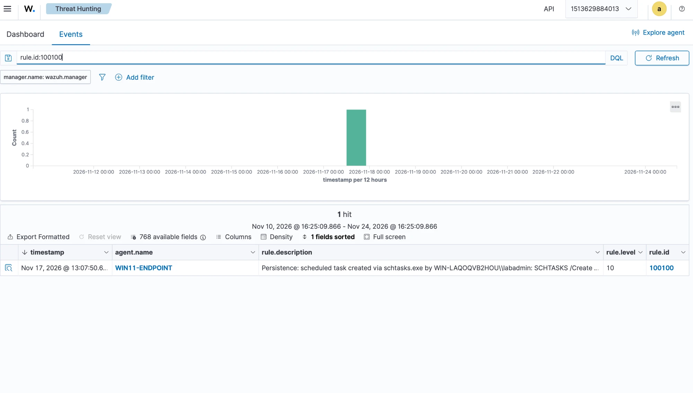

# Home SOC Lab: Wazuh SIEM + Detection Engineering

A self-hosted Security Operations Center lab on Apple Silicon. Windows and Linux endpoints send telemetry to a
Wazuh SIEM. I simulate real attacker techniques with Atomic Red Team, investigate the alerts, find detection gaps,
write custom rules mapped to MITRE ATT&CK, and document each investigation as an incident report.

**Highlights**
- Deployed Wazuh 4.14.10 (manager, indexer, dashboard) in Docker. Locked the dashboard, API, and indexer to
  localhost, replaced all default credentials, and kept secrets out of the repo.
- Built a Windows 11 endpoint with **Sysmon** and **PowerShell script block logging** forwarding to Wazuh, plus a
  containerized Ubuntu endpoint with SSH as an attack target.
- Found that Wazuh's built-in rules rated scheduled-task persistence as **level 3** and mapped it to the wrong
  technique. Wrote **custom rule 100100** (level 10, T1053.005) and validated it with positive and negative tests.
  → [IR-001](incident-reports/IR-001-scheduled-task-persistence.md)



## Architecture

```
 Atomic Red Team (on endpoint) / Kali ──attacks──▶ Endpoints
                                                   ├─ WIN11-ENDPOINT: Windows 11 ARM VM (UTM), Sysmon + PowerShell logging
                                                   └─ linux-endpoint-01: Ubuntu 24.04 container, SSH + auth.log
                                                          │  Wazuh agent (1514/tcp)
                                                          ▼
                              Wazuh Manager ──▶ Wazuh Indexer ──▶ Wazuh Dashboard (https://localhost)
                              (rules, custom detections)
```

| Component | Where | Notes |
|---|---|---|
| Wazuh 4.14.10 (manager, indexer, dashboard) | `wazuh/` | Official single-node Docker deployment; dashboard, API, and indexer bound to `127.0.0.1` |
| Windows 11 ARM endpoint (`WIN11-ENDPOINT`) | UTM VM | Sysmon ([SwiftOnSecurity config](https://github.com/SwiftOnSecurity/sysmon-config)), PowerShell script block logging, Wazuh agent: [`endpoints/windows/install-agent.ps1`](endpoints/windows/install-agent.ps1) |
| Atomic Red Team | WIN11-ENDPOINT | Adversary simulation from Red Canary (`C:\AtomicRedTeam`, Defender folder exclusion) |
| Linux endpoint (`linux-endpoint-01`) | `endpoints/linux/` | Ubuntu 24.04 + SSH (`127.0.0.1:2222`) + Wazuh agent. Includes a deliberately weak lab user for brute-force tests |
| Kali attacker | UTM VM | _Planned_ |

## Detections validated

| # | Technique (MITRE ATT&CK) | Simulation | Wazuh rule | Level | Report |
|---|---|---|---|---|---|
| 1 | T1110.001 Brute Force: Password Guessing | 10 failed SSH logins with invalid users | 5710 → 5712 (built-in) | 10 | _todo_ |
| 2 | T1053.005 Scheduled Task | Atomic Red Team T1053.005-2 | **[100100 (custom)](detections/T1053.005-scheduled-task-creation.xml)**, replaced built-in 92032 (L3, wrong mapping) | 10 | [IR-001](incident-reports/IR-001-scheduled-task-persistence.md) |

## Running it

**1. Secrets.** Copy the templates and set your own passwords:
```bash
cd wazuh
cp .env.example .env
cp config/wazuh_dashboard/wazuh.yml.example config/wazuh_dashboard/wazuh.yml
cp config/wazuh_indexer/internal_users.yml.example config/wazuh_indexer/internal_users.yml
```
`.env`, `wazuh.yml`, and `internal_users.yml` are gitignored. The templates ship with Wazuh's public defaults.
Change them using [Wazuh's password procedure](https://documentation.wazuh.com/current/deployment-options/docker/wazuh-container.html)
(hash with `hash.sh`, update `internal_users.yml`, then apply with `securityadmin.sh`).

**2. Certificates and SIEM** (first run only for the certs):
```bash
docker compose -f generate-indexer-certs.yml run --rm generator
docker compose up -d
```

**3. Load custom detections:**
```bash
docker cp ../detections/T1053.005-scheduled-task-creation.xml wazuh-wazuh.manager-1:/var/ossec/etc/rules/
docker exec wazuh-wazuh.manager-1 /var/ossec/bin/wazuh-control restart
```

**4. Linux endpoint:**
```bash
cd ../endpoints/linux && docker compose up -d
```

**5. Windows endpoint:** create a Windows 11 ARM VM in UTM (TPM and Secure Boot via the UTM wizard), then run
`endpoints/windows/install-agent.ps1` in an admin PowerShell (set `$Manager` to your host's UTM bridge IP).

Dashboard: https://localhost (self-signed certificate).

## Layout
- `detections/`: custom Wazuh rules (XML) mapped to ATT&CK
- `incident-reports/`: one write-up per investigation (timeline, indicators, analysis, detection, response)
- `docs/screenshots/`: dashboard evidence
- `endpoints/`: endpoint build and agent setup
- `wazuh/`: SIEM deployment (based on [wazuh/wazuh-docker](https://github.com/wazuh/wazuh-docker) v4.14.10 single-node)
- `attacks/`: attack notes _(coming)_
