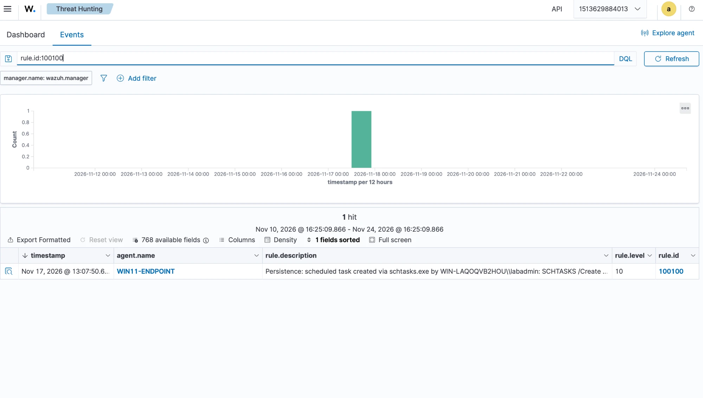
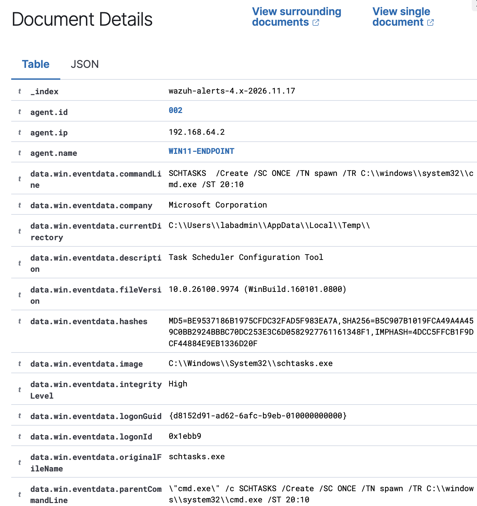
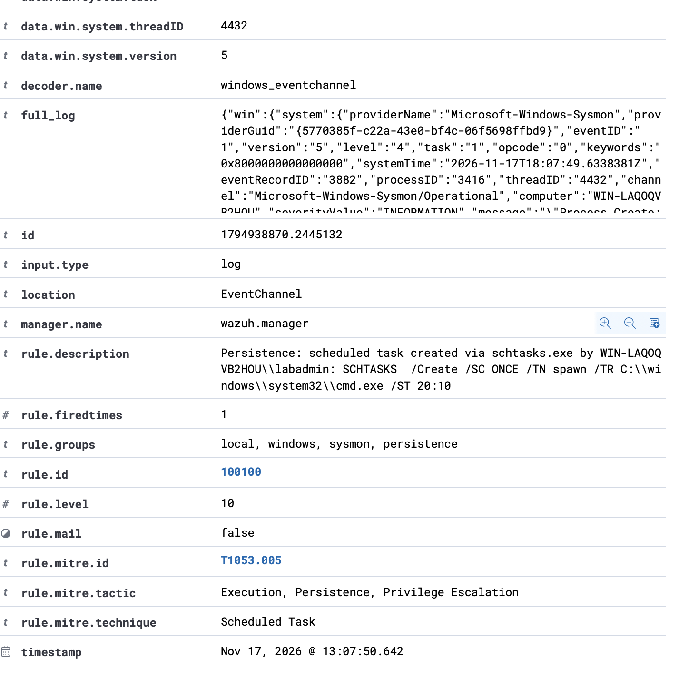
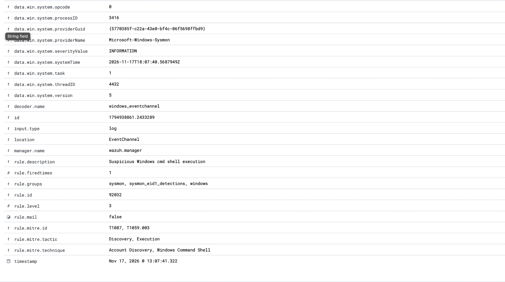
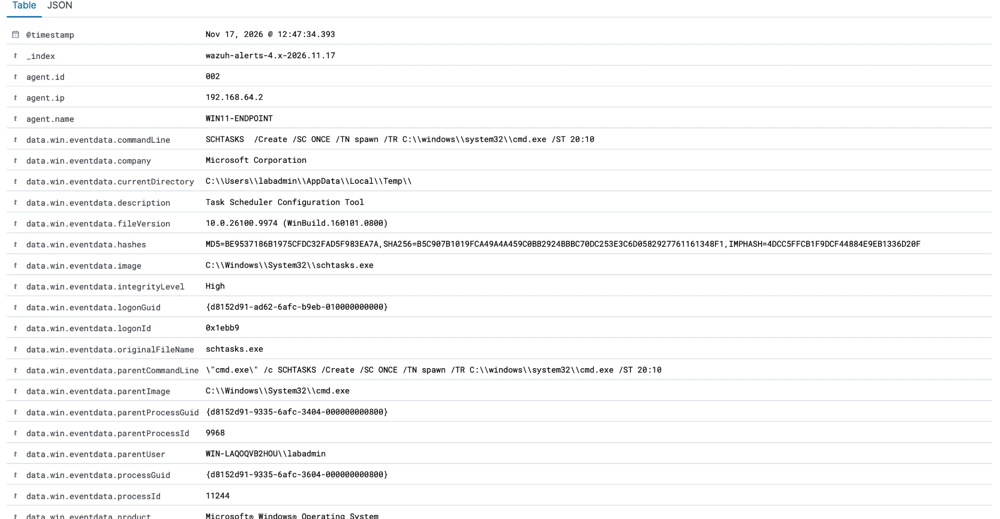
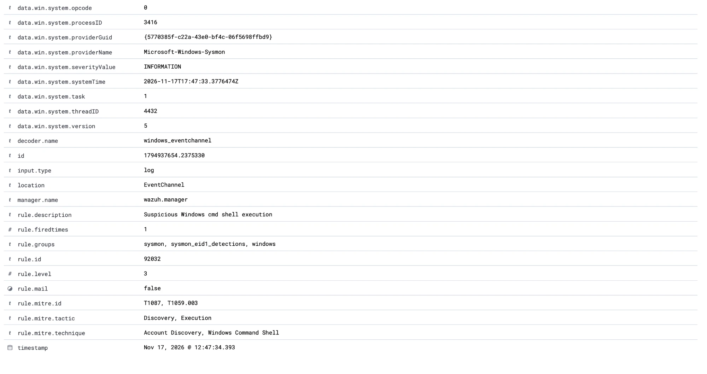

# IR-001: Scheduled Task Persistence on WIN11-ENDPOINT

| | |
|---|---|
| **Date** | 2026-11-17 |
| **Analyst** | David Alabi |
| **Host** | WIN11-ENDPOINT (hostname `WIN-LAQOQVB2HOU`), Windows 11 ARM |
| **User** | `labadmin` (local administrator) |
| **ATT&CK** | [T1053.005 Scheduled Task/Job: Scheduled Task](https://attack.mitre.org/techniques/T1053/005/), Persistence / Execution |
| **Simulation** | Atomic Red Team `T1053.005-2` "Scheduled task Local" |
| **Severity** | High (persistence mechanism) |
| **Outcome** | Detected. Initial detection was low-fidelity; a custom rule (100100) was written and validated |

## Summary
A scheduled task named `spawn` was created from PowerShell to launch `cmd.exe` at 20:10. Attackers use scheduled
tasks to keep access after a reboot or logoff. Wazuh's built-in rules recorded the activity but labeled it as
generic command-shell use (level 3–4) and mapped it to the wrong technique (T1087 Account Discovery). In a real
SOC queue that alert would likely be missed. I wrote custom rule **100100** to flag task creation at level 10 with
the correct ATT&CK mapping, then re-ran the simulation to confirm it fires.

## Timeline (UTC)
| Time | Event | Source |
|---|---|---|
| 17:47:34.377 | `powershell.exe` spawns `cmd.exe /c SCHTASKS /Create /SC ONCE /TN spawn /TR C:\windows\system32\cmd.exe /ST 20:10` | Sysmon EID 1 → Wazuh rule 92004 (L4) |
| 17:47:34.393 | `cmd.exe` spawns `schtasks.exe` with the same `/Create` arguments | Sysmon EID 1 → Wazuh rule 92032 (L3, mapped T1087) |
| ~18:03 | Custom rule 100100 deployed to the Wazuh manager | Detection engineering |
| 18:07:41 | Cleanup: `SCHTASKS /Delete /TN spawn /F` | Sysmon EID 1 → rule 92032 (L3); rule 100100 correctly did **not** fire |
| 18:07:50.642 | Simulation re-run, `schtasks.exe /Create` observed | **Rule 100100 (L10, T1053.005)** |

## Indicators
| Type | Value |
|---|---|
| Process | `C:\Windows\System32\schtasks.exe` |
| Command line | `SCHTASKS /Create /SC ONCE /TN spawn /TR C:\windows\system32\cmd.exe /ST 20:10` |
| Process chain | `powershell.exe` → `cmd.exe` → `schtasks.exe` |
| Task name | `spawn` (root task folder `\`) |
| Task action | `C:\windows\system32\cmd.exe` |

## Analysis
- **Process lineage is the key signal.** An interactive PowerShell launching `cmd.exe`, which then launches
  `schtasks.exe /Create`, is unusual for a normal user. Software installers normally register tasks through the
  Task Scheduler API, not by running `schtasks.exe` from a shell.
- **The task action matters.** Here the task launches a shell (`cmd.exe`). In a real intrusion the `/TR` value
  would point to the attacker's payload, often in a user-writable path like `%APPDATA%` or `%TEMP%`.
- **Detection gap found.** Built-in rules captured the event but did not give it the right meaning
  (low level, wrong ATT&CK mapping). Data was collected, but it was not turned into a usable alert.

## Detection
Custom rule: [`detections/T1053.005-scheduled-task-creation.xml`](../detections/T1053.005-scheduled-task-creation.xml)
- Trigger: Sysmon EID 1 where `image` ends in `\schtasks.exe` and the command line contains `/create`
- Level 10, mapped to T1053.005
- Validated: fired on the re-run (18:07:50); did not fire on the task deletion (18:07:41)

**Known limitations / next improvements**
- Does not catch tasks created through PowerShell `Register-ScheduledTask`, WMI, or the COM API
  (Atomic tests T1053.005-4 and -6). Planned: add a rule on Windows Security **Event ID 4698** (scheduled task
  created). That requires enabling the "Audit Other Object Access Events" policy.
- Legitimate admin tools and installers may use `schtasks /create`. In production, tune with an allowlist of
  known parent processes or task names.

## Response (what I would do in production)
1. **Contain:** isolate the host if the task action points to an unknown binary.
2. **Investigate:** `schtasks /query /tn <name> /v /fo list`. Review the action, run-as user, and trigger, and
   hash the target binary.
3. **Eradicate:** `schtasks /delete /tn <name> /f`, then remove the payload.
4. **Scope:** search all endpoints for the same task name or command line in Wazuh.

## Remediation in lab
Task removed with `Invoke-AtomicTest T1053.005 -TestNumbers 2 -Cleanup`.

## Evidence
**Rule 100100 firing in Wazuh Threat Hunting** (dashboard shows local time, UTC-5):

**Alert details:** command line, parent process, integrity level, working directory, and hashes:

**Rule metadata:** level 10, custom `local` group, ATT&CK T1053.005 with tactics Execution, Persistence, and Privilege Escalation:

Notable fields from the details view:
- `integrityLevel: High`: the task was created with administrative rights.
- `currentDirectory: C:\Users\labadmin\AppData\Local\Temp\`: executed from a user temp folder, a common staging location for malware.
- `company: Microsoft Corporation`, `originalFileName: schtasks.exe`: a legitimate signed Windows binary being abused ("living off the land").
- SHA256 `B5C907B1019FCA49A4A459C0BB2924BBBC70DC253E3C6D0582927761161348F1` (schtasks.exe), available for reputation lookup.

**Negative test: cleanup (`SCHTASKS /Delete`) at 13:07:41 local.** The built-in rule 92032 fired at level 3 with the wrong
mapping (T1087 Account Discovery). Custom rule 100100 correctly did not fire on task deletion:

**Before: the original attack (`SCHTASKS /Create`) at 12:47:34 local, before rule 100100 existed.**
The event data was fully captured (command line, parent `cmd.exe`, High integrity)...

...but the only matching rule labeled it **level 3** "Suspicious Windows cmd shell execution", mapped to
**T1087 Account Discovery**. That severity and mapping are wrong for a persistence technique:

